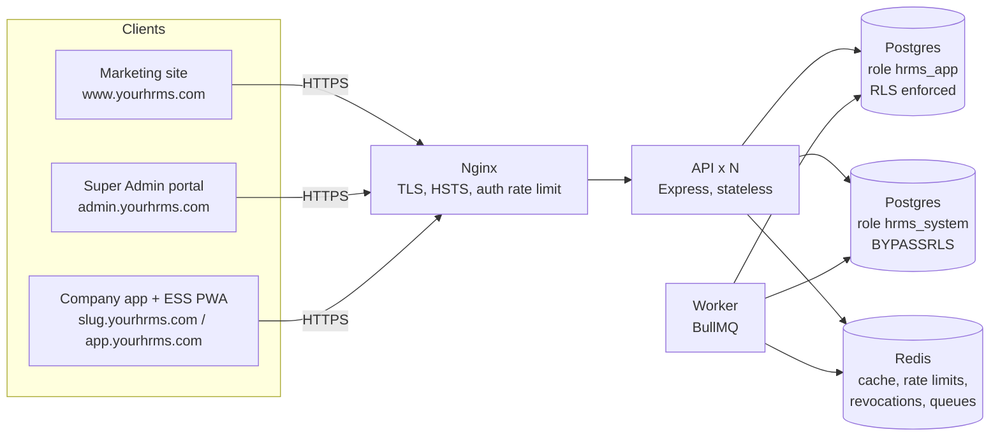
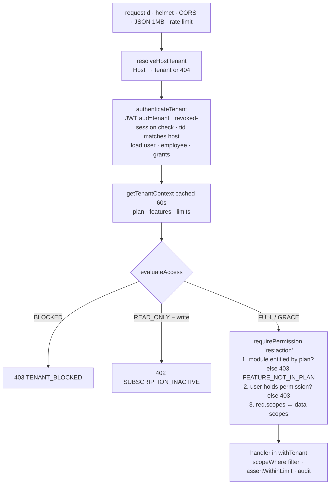
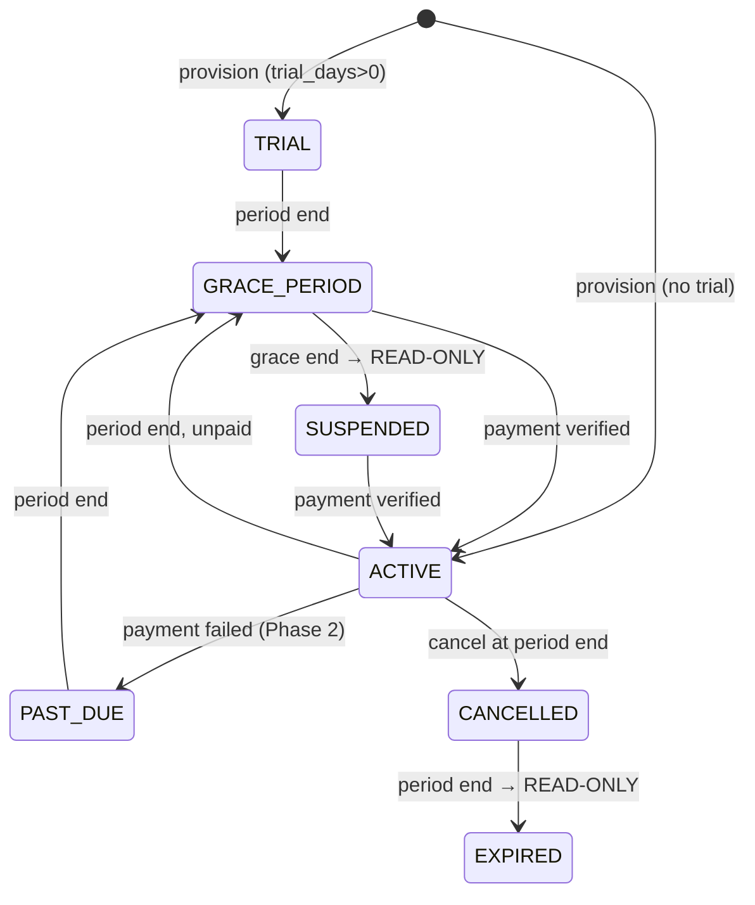

# Architecture

## 1. System shape

One codebase, one database, shared application (as the brief requires initially). The API is stateless so it scales horizontally behind Nginx; Redis holds anything that must be shared between instances.

## 2. Multi-tenancy — four independent layers

A request can only touch another tenant's data if **all four** layers fail at once.

| Layer | Mechanism | Where |
|---|---|---|
| 1. Identity | Tenant comes from the verified **Host → tenant_domains** mapping and/or the **signed JWT `tid` claim**. If both exist they must match (`TENANT_MISMATCH`). Client-supplied tenant ids are never read. | `middleware/tenant.js` |
| 2. Database session | Every tenant request runs in `withTenant(tenantId, fn)`: a transaction on the `hrms_app` pool that first runs `set_config('app.tenant_id', id, true)` (transaction-local, so it cannot leak through the pool). | `database/index.js` |
| 3. Row-Level Security | Every tenant table has `ENABLE` + `FORCE ROW LEVEL SECURITY` and a policy `tenant_id = current_tenant_id()` for both reads (USING) and writes (WITH CHECK). With no tenant set the role sees **nothing** (fails closed). | migration `002` |
| 4. Composite foreign keys | Intra-tenant references are `(tenant_id, x_id) → (tenant_id, id)`, so even the BYPASSRLS system role cannot link an employee to another tenant's branch. | migration `001` |

**Three database roles**

| Role | Used by | Rights |
|---|---|---|
| `hrms_owner` | migrations, backups, maintenance | owns schema; BYPASSRLS; never used by the running app |
| `hrms_app` | all tenant request handling, tenant jobs | NOBYPASSRLS; least-privilege grants; no access to `platform_*`, `auth_sessions`; audit log is INSERT/SELECT only |
| `hrms_system` | Super Admin API, tenant resolution, auth sessions, provisioning, schedulers | BYPASSRLS; must scope by explicit `tenant_id`; cannot UPDATE/DELETE audit logs |

`tests/tenant-isolation.test.js` asserts all of this automatically, including a catalogue check that **every table with a `tenant_id` column has RLS enabled and forced**, so a future migration that forgets RLS fails CI.

**Enterprise dedicated database (design, Phase 7).** `tenants.deployment_mode = 'DEDICATED'` + `dedicated_db_ref` (a secret-manager key, never a raw URL). A connection-router will pick the pool by tenant inside `withTenant`. The same migrations and code run against it, so there's no separate codebase.

## 3. Request pipeline (tenant routes)

The subscription middleware covers all eight checks the brief lists: tenant status, subscription status, expiry, module entitlement, employee limit, branch limit, storage limit, and permissions. None of them rely on hiding things in the frontend.

## 4. Subscription engine

* **Catalogue in the DB:** `plans`, versioned `plan_prices` (never updated in place; the old row is closed and a new one opened), `feature_catalog`, `plan_entitlements`. Per-tenant overrides live on `subscriptions` (`max_*_override`) and `subscription_items` (add-on modules, extra seats).
* **Effective context** = plan entitlements ∪ core features ∪ add-ons. Limits = override ?? plan limit, plus any extras. The context is cached in Redis for 60 s and **invalidated explicitly** on every change, so Super Admin edits apply immediately.
* **Race-safe limits:** `assertWithinLimit` takes `pg_advisory_xact_lock(tenant:metric)` before counting. The test fires 6 concurrent creates at 2 free seats and checks exactly 2 succeed.
* **State machine** (worker sweep every 15 min; access is *also* computed from timestamps at request time, so a late job never grants or blocks wrongly):

Read-only means GETs, auth and (from Phase 2) billing still work. Data is **never deleted**. Each transition writes `subscription_events` + `audit_logs` and emails tenant owners and admins.

## 5. Authentication

* Argon2id (m=19 MiB, t=2, p=1), constant-time behaviour for unknown users, lockout after 5 failures (configurable), rate limits per IP+email in the API and per IP in Nginx.
* Access JWT (HS256, 15 min, `aud` = `tenant` or `platform`, `sid` = session family).
* Refresh token: 256-bit random, stored as SHA-256, **rotated on every use**, in an `httpOnly; Secure; SameSite=Strict` cookie scoped to the auth path. Mobile clients (`X-Client: mobile`) get it in the body. Cookie-based refresh requires `X-Requested-With`, which forces a CORS preflight (CSRF defence).
* **Reuse detection:** replaying a rotated token revokes the whole family. Logout, password change/reset and tenant suspension revoke families in the DB **and** in Redis, so outstanding access tokens die immediately instead of at expiry.

## 6. RBAC

* Permissions are a global catalogue `"<resource>:<action>"` (actions: view, create, edit, delete, approve, reject, export, import, configure, manage). Each maps to a module, which ties it to plan entitlements.
* Roles are per tenant. The 12 default roles from the brief are copied in at provisioning and stay editable (except Company Owner).
* Data scopes per grant: OWN, DIRECT_REPORTS, DEPARTMENT, BRANCH, SELECTED_BRANCHES, COMPANY. A user's access is the OR across their roles. `scopeWhere()` turns this into SQL; `recordInScope()` checks writes. Out-of-scope reads return 404, the same as a missing record.
* Anti-escalation: you can only grant permissions (and scopes) you hold yourself. The last Company Owner can't be removed.
* Platform staff have separate roles (Super/Platform/Finance/Sales/Marketing/Support/Technical Admin), separate tokens (`aud=platform`) and separate permissions.

## 7. Background jobs

BullMQ on Redis. Any job that touches tenant data must carry `tenantId` and run its work through `withTenant`, so RLS applies in workers just as in the API. Jobs get 5 attempts with exponential backoff and keep their history for 7 days (completed) or 30 days (failed).

## 8. Key decision: Sequelize instead of Prisma

The brief allows either. Prisma's CLI needs native engine binaries downloaded from `binaries.prisma.sh` at install time, and that wasn't reachable in the build environment, so migrations couldn't have been run or tested. Sequelize is pure JavaScript. Hand-written SQL migrations also give full control over RLS policies, composite FKs, partial unique indexes and grants, which ORM migration generators handle poorly. Models map columns only; the SQL migrations are the source of truth.
