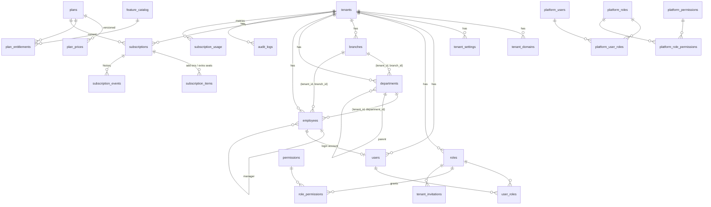

# Database schema (foundation tables; later tables follow the same conventions, see migrations 004–006)

Source of truth: `backend/src/database/migrations/*.sql` (applied in order, checksummed, advisory-locked).

## ER diagram

## Tables

| Group | Table | Tenant-owned (RLS) | Notes |
|---|---|---|---|
| Platform | `platform_users`, `platform_roles`, `platform_permissions`, `platform_role_permissions`, `platform_user_roles` | – | Lishnu Tech staff. App role has no access. |
| Auth | `auth_sessions` | – (system only) | Refresh-token families, SHA-256 hashes, rotation chain, revocation reason. |
| Auth | `auth_action_tokens` | – (system only) | Password reset and email verification, single use. |
| Tenancy | `tenants` | self-row policy | Status, locale, timezone (Asia/Kathmandu), currency (NPR), BS/AD preference, deployment mode. |
| Tenancy | `tenant_domains` | ✓ | Subdomain or verified custom domain; one primary per tenant. |
| Tenancy | `tenant_settings` | ✓ | Key/JSON config (financial year, work week, ID format, branding). |
| Org | `branches`, `departments`, `employees` | ✓ | Composite FKs, soft delete, check constraints (no self-manager, exit ≥ join). |
| Access | `users`, `roles`, `role_permissions`, `user_roles`, `tenant_invitations` | ✓ | `permissions` is a global catalogue (read-only to app). |
| Subscriptions | `feature_catalog`, `plans`, `plan_prices`, `plan_entitlements` | – (read-only to app) | Prices are versioned (`effective_from/to`, one open row per plan, cycle and currency). |
| Subscriptions | `subscriptions` | ✓ (read-only to app) | One *live* subscription per tenant (partial unique index). Holds previous/pending plan, overrides, period and grace dates. |
| Subscriptions | `subscription_items`, `subscription_events`, `subscription_usage` | ✓ | Add-ons, full history, metered usage (storage, later AI/SMS). |
| Audit | `audit_logs` | ✓ (NULL tenant = platform) | Append-only: UPDATE/DELETE revoked from app and system roles. |

## Conventions (apply to every future table)

1. `id uuid PRIMARY KEY DEFAULT gen_random_uuid()`, `created_at`/`updated_at timestamptz` (trigger `set_updated_at`).
2. Tenant-owned ⇒ `tenant_id uuid NOT NULL REFERENCES tenants(id)`, `UNIQUE (tenant_id, id)`, tenant-leading indexes.
3. References to other tenant tables use **composite FKs** `(tenant_id, x_id)`.
4. Add the table to the RLS loop in a new migration (`ENABLE` + `FORCE` + `tenant_isolation` policy + `owner_all`), and grant `hrms_app` only what it needs. The isolation test fails until you do.
5. History is append-only (`*_history`, `*_events`). Never overwrite salary, payroll, transfer or subscription records.
6. Money `numeric(14,2)`; statuses `text + CHECK`; dates without time `date`; instants `timestamptz` (UTC).
7. Never edit an applied migration. The runner refuses on checksum mismatch.

## Phase roadmap for the catalogue in the brief

Attendance, leave, payroll (with versioned `tax_rules` / `contribution_rules`), recruitment, performance, assets, workflows, custom fields, notifications, files, CMS and CRM tables arrive in their phases, following the conventions above.
